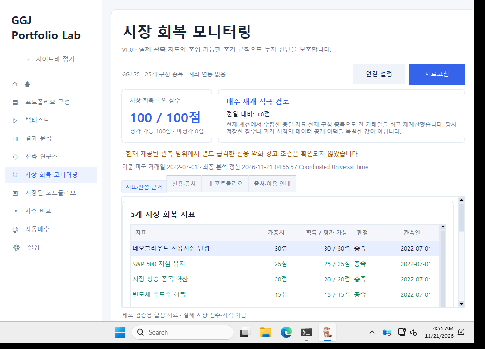
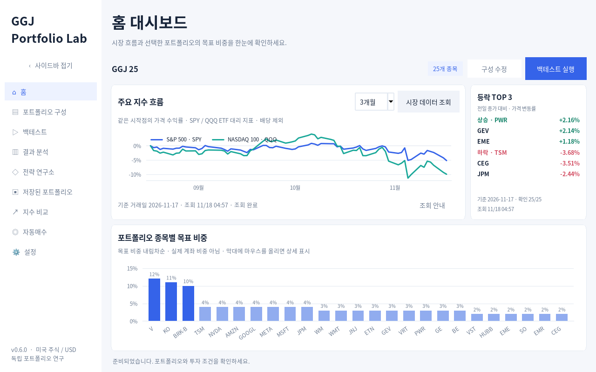

# GGJ Portfolio Lab

미국 주식·ETF 분석과 시장 회복 모니터링, **실제 계좌 정기매수·즉시매수**를 제공하는 Windows 통합 투자 프로그램입니다.

이 저장소는 설치 파일과 버전별 변경 사항을 배포하는 전용 저장소입니다. 개발 소스, 계좌·인증 정보와 사용자 데이터는 포함하지 않습니다. v0.8.0 설치 EXE에는 검증된 AutoBuy 실행 모듈이 함께 포함됩니다.

## 설치

1. [Windows 설치 파일 다운로드](https://github.com/audrlf56264832-collab/-ggj-portfolio-lab/releases/latest/download/GGJPortfolioLab-Setup.exe)를 누릅니다. [버전별 변경 사항](https://github.com/audrlf56264832-collab/-ggj-portfolio-lab/releases)도 확인할 수 있습니다.
2. 설치 파일을 더블클릭해 사용자별 설치를 진행합니다. Python 설치나 GitHub 로그인이 필요하지 않습니다.
3. 바탕화면 또는 시작 메뉴의 **GGJ Portfolio Lab**을 실행합니다.

Windows x64용입니다. 릴리스에는 설치 파일과 `GGJPortfolioLab-Setup.exe.sha256` 체크섬을 함께 제공합니다. 현재 설치 파일은 코드 서명이 없어 Windows SmartScreen 경고가 나타날 수 있습니다.

## 업데이트와 데이터

프로그램의 **설정 → 업데이트 확인**에서 최신 버전과 변경 사항을 확인하고, 원하는 경우 **업데이트 설치**를 선택합니다. 자동으로 승인 없이 설치하지 않습니다.

사용자 데이터는 `%LOCALAPPDATA%\GGJPortfolioLab\`의 `portfolios`, `studies`, `cache`에 보관됩니다. 설치·업데이트·기본 제거 과정에서 이 데이터를 삭제하지 않습니다. 기존 ZIP 버전에서 사용하던 같은 위치의 데이터도 계속 사용할 수 있습니다.

과거 성과는 미래 수익을 보장하지 않습니다. **v0.8.0부터 실제 계좌 주문 기능이 있습니다. 즉시매수 실행 버튼은 추가 확인창 없이 주문을 요청합니다.**

## v0.8.2 지수 비교 빈 화면 수정

지수 비교 메뉴를 처음 열 때 제목만 표시되던 화면 배치 문제를 수정했습니다. 본문 영역이 1×1픽셀로 남던 문제이며, 성과 계산이나 주문 기능은 변경하지 않았습니다.

계좌·가격 자료가 없어도 **성과 차트 / 기간·비교 설정 / 과거 복원·자료 보완 / 25종목 순위**와 갱신 버튼·데이터 부족 안내가 표시됩니다. 기존 사용자는 **설정 → 업데이트 확인 → 업데이트 설치** 또는 [v0.8.2 설치 파일](https://github.com/audrlf56264832-collab/-ggj-portfolio-lab/releases/download/v0.8.2/GGJPortfolioLab-Setup.exe)을 이용하세요. 기존 데이터는 유지됩니다.

Windows에 설치한 EXE에서 실제 메뉴 첫 진입을 검증하고 캡처를 확인했습니다: [빈 자료 차트](docs/index-v0.8.2-windows-empty.png) · [기간·벤치마크 설정](docs/index-v0.8.2-windows-empty-settings.png) · [과거 복원·CSV](docs/index-v0.8.2-windows-empty-restoration.png) · [25종목 순위](docs/index-v0.8.2-windows-empty-ranking.png) · [합성 자료 차트](docs/index-v0.8.2-windows-synthetic.png). 마지막 차트는 배포 검증용 합성 자료이며 실제 계좌 성과가 아닙니다. 사용자 PC의 실제 계좌 인증·주문은 개발 검증에 사용하지 않았습니다.

## v0.8.1 기존 GGJ 25 Index 성과 분석 복원

**지수 비교** 메뉴에 기존 AutoBuy 1.2의 실제 성과 분석을 복원했습니다. 전체 UI를 바꾸지 않고 성과 차트·기간/비교 설정·과거 복원/자료 보완·25종목 순위 탭으로 제공합니다.

- 기준일 **2026-10-28 미국 장 마감**, 시작 지수 **1,000**, 입출금을 구분하는 기본 TWR과 선택형 **Modified Dietz 일중 흐름 근사**를 유지합니다. 추정치는 정확한 TWR과 구분합니다.
- S&P 500 총수익지수 우선·가격지수 대용 표시, Nasdaq 100·기존 ETF/종목 비교, 기준일 누적/기간 재정규화, 누적·기간 수익률·초과수익률·MDD와 차트 확대·이동·날짜 확인을 복원했습니다.
- 기존 과거 복원·누락 안내·USD 현금 보완·7개 CSV 양식과 가져오기를 사용할 수 있습니다. 실제 수량·현금·원장이 없으면 임의로 채우거나 정상 성과처럼 표시하지 않습니다.
- 기존 `%LOCALAPPDATA%\GGJ AutoBuy\performance\performance.sqlite3`를 읽습니다. 원본 주문 DB는 읽기 전용이며, 같은 실행 주체의 인증 세션으로 GET 한 건씩 조회하고 실제 주문을 우선합니다. 정기매수·즉시매수·회복 모니터는 유지합니다.

지수 값이 계산 불가이면 **과거 복원·자료 보완 → 누락 자료 안내**에서 필요한 실제 자료를 확인하세요. 주문 금액만으로 과거 보유 수량이나 현금을 만들지 않습니다. CSV 양식은 프로그램에서 직접 저장할 수 있습니다. 실제 개인 계좌의 기준일 성과 복원 성공 여부는 사용자 자료로 확인해야 합니다.

[Windows 성과 분석 화면](docs/index-v0.8.1-windows-synthetic.png)은 **입출금·가격을 합성한 검증용 자료**입니다. 실제 계좌 수익률이나 시장 데이터가 아닙니다.

## v0.8.0 통합 투자 프로그램

기존 분석 화면과 수달 아이콘을 유지하고 **자동매수** 메뉴에 기존 AutoBuy의 설정·미리보기·KST/ET 예약·주문 및 체결 이력을 연결했습니다. 별도 **즉시매수** 메뉴에서 아래 두 방식을 선택합니다.

- **정기매수 앞당기기:** 이번 미국 동부시간 투자 주간의 기존 예산·허용 종목·공통 매수강도로 실행합니다. 첫 전송부터 같은 주 예약을 건너뛰며 부분 실패·접수 미확인·재시작에도 중지 기록을 유지합니다.
- **추가 기회매수:** 별도 USD 금액과 종목을 직접 선택합니다. 센트 균등 배분·개별 수정·현금 잔액을 지원하며 정기 예산·금지 종목·예약을 변경하지 않습니다.

실제 주문은 검증된 기존 엔진이 처리합니다. 접수·체결·실패·미확인을 구분하고 중복 클릭·접수 미확인 자동 재전송을 차단합니다. 시장 점수는 주문을 실행하지 않으며 회복 모니터의 즉시매수 버튼은 메뉴 이동만 합니다.

[정기매수 화면](docs/trading-v0.8.0-windows-synthetic.png) · [즉시매수 화면](docs/immediate-v0.8.0-windows-synthetic.png)은 **Windows 설치형을 모의 브로커·합성 계좌로 검증한 캡처**이며 실제 계좌 주문 내역이 아닙니다.

인증과 주문 기록은 기존 `%LOCALAPPDATA%\GGJ AutoBuy\`, 분석·저장 연구는 `%LOCALAPPDATA%\GGJPortfolioLab\`에 유지합니다. 독립 AutoBuy를 제거하지 않습니다. 동일한 실행 잠금을 공유하므로 독립본이 실행 중이면 통합본은 이력 조회만 하고 주문·예약을 실행하지 않습니다. 기존 실행 주체가 종료되면 통합본이 다시 연결합니다. 앞당기기 후 독립본을 사용해도 같은 주 중복 예약을 건너뜁니다.

**처음 실행하면 자동매수 화면에서 기존 예산·종목·예약을 확인하세요.** 인증 설정이 없으면 **설정 → 토스 API 연결 설정**에서 계좌 조회 후 저장합니다. 프로그램이 켜져 있어야 예약이 실행되고 새 날짜 예산은 기존 방식대로 별도 저장합니다. 실제 계좌 주문은 개발 테스트로 실행하지 않았으며 모의 브로커·임시 DB와 Windows 설치형 검증으로 확인합니다.

## v0.7.0 시장 회복 모니터링 v1.0

새 **시장 회복 모니터링** 메뉴에서 신용시장 30점, SPY 저점 유지 25점, 시장 상승 종목 확산 20점, 반도체 상대강도 15점, VIX 10점과 한국어 판단 근거를 확인합니다. 실제 관측일·출처·평가 가능/미평가 점수를 구분하며, 급격한 신용 악화는 총점과 별도로 표시합니다. 이 기준은 통계적으로 검증된 예측 모델이 아닌 초기 사용자 규칙입니다.

실행 시와 실행 중 매시간 백그라운드에서 조회하며 **새로고침**도 사용할 수 있습니다. 첫 조회는 전체 구성 종목을 요청하므로 수십 초에서 수 분이 걸릴 수 있습니다. 현재 게시 S&P 500 명단의 실제 종목 자료가 일부라도 부족하면 확산 점수를 미평가합니다. 누락을 임의 값이나 다른 종목으로 대신하지 않습니다. 전일 점수는 현재 자료·규칙으로 회고 재계산한 참고치입니다.

**설정 → 회복 모니터 설정**에서 본인 [FRED API 키](https://fred.stlouisfed.org/docs/api/api_key.html)를 입력할 수 있습니다. 키가 없으면 해당 10점은 미평가하고 다른 자료는 조회합니다. Windows에서는 키를 사용자 계정으로 암호화 저장합니다. 채권·FRED/ICE 및 시장 원시 자료와 점수 이력은 세션 메모리에서만 사용합니다. 이 v0.7.0 설명의 시장 회복 기능 자체는 실제 계좌 주문을 실행하지 않습니다.

내 포트폴리오는 선택한 **목표 구성**의 1·5·20거래일 참여율과 SPY 대비 가격 수익률을 별도로 표시합니다. 실제 계좌 보유 현황·배당 포함 운용 수익률과 구분합니다. 기존 백테스트·연구·워크포워드·저장 데이터·수달 아이콘과 업데이트 방식은 유지합니다.

출처: [Atlantis Data Solutions](https://atlantisdatasolutions.com/terms-of-service), [FRED/ICE BAMLH0A0HYM2](https://fred.stlouisfed.org/series/BAMLH0A0HYM2), [SEC EDGAR](https://www.sec.gov/edgar), [Yahoo Finance / yfinance](https://ranaroussi.github.io/yfinance/index.html), [Wikipedia 현재 S&P 500 명단](https://en.wikipedia.org/wiki/List_of_S%26P_500_companies) ([CC BY-SA 4.0](https://creativecommons.org/licenses/by-sa/4.0/)). 현재 게시 명단은 과거 공식 구성 이력과 다릅니다. Atlantis 무료 최근 범위 밖의 이력·누락 YTM은 추정하지 않습니다.

This product uses the FRED® API but is not endorsed or certified by the Federal Reserve Bank of St. Louis.

아래는 Windows 설치형의 **합성 자료를 사용한 기능 검증 화면**입니다. 표시 점수와 관측일은 실제 현재 시장 데이터가 아닙니다.

## v0.6.2 경량 성능 개선

기존 디자인·수달 아이콘·계산·저장·업데이트를 유지하면서 카드 배경 그리기 비용, 불필요한 연구 차트 재생성, 시작 시 연구 목록 전체 복원을 줄였습니다. 저장된 연구는 해당 탭 첫 진입 때 백그라운드로 조회하며, 명시적 새로고침은 다시 읽고 검증합니다.

동일 Windows CI의 소스 GUI 측정(합성 연구 3개·포트폴리오 25개, 재방문 5회 중앙값):

| 동작 | v0.6.1 | v0.6.2 |
|---|---:|---:|
| 결과 분석 메뉴 | 649.6 ms | 50.3 ms |
| 전략 연구소 메뉴 | 679.2 ms | 67.4 ms |
| 연구 비교 기준 변경 | 39.3 ms | 3.3 ms |

콜백과 대기 중 화면 그리기 완료까지의 시간입니다. 사용자 PC 수치는 다를 수 있으며 전체 EXE 시작 시간은 아닙니다. 차트의 최초 그리기·큰 파일의 검증 완료에는 여전히 시간이 걸릴 수 있습니다.

## v0.6.1 공식 수달 아이콘

조개를 든 공식 수달 아이콘을 바탕화면·시작 메뉴 바로가기, 작업 표시줄·프로그램 창과 설치 EXE에 적용했습니다. 기존 화면 배치와 계산·저장·업데이트 방식은 그대로입니다.

작업 표시줄에 이전 고정 아이콘이 남으면 앱을 닫고 고정을 해제한 뒤 새 시작 메뉴 항목에서 다시 고정하세요. 사용자 데이터나 캐시 파일을 삭제하지 마세요.

[Windows 설치형의 창·작업 표시줄 아이콘 확인 화면](docs/icon-v0.6.1-windows.png)

## v0.6.0 화면

공통 모던 화이트 테마, 접을 수 있는 9개 메뉴와 홈 대시보드를 제공합니다. 홈에서 **시장 데이터 조회**를 누르면 SPY·QQQ 지수 추종 ETF의 가격 수익률과 선택 포트폴리오의 최근 거래일 등락 TOP 3을 조회합니다. 아래는 실제 계좌 비중이 아닌 **전체 종목 목표 비중**입니다. 지수 비교·자동매수 메뉴는 추후 연결 안내만 표시합니다.

아래 홈 화면은 Linux 개발 환경에서 GGJ 25 프리셋과 실제 Yahoo 가격을 조회한 캡처이며 시각은 UTC입니다. Windows에서는 맑은 고딕을 사용합니다.

[목표 비중 툴팁 화면](docs/target-tooltip-v0.6.0.png) · [전략 연구소 화면](docs/research-v0.6.0.png)
